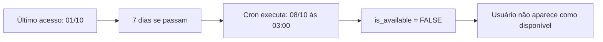
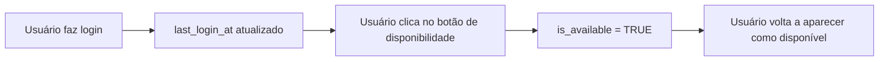

# ⏰ Cron Job - Desativar Usuários Inativos (7 Dias)

**Data de Criação:** 30/10/2025

## 📋 Objetivo

Configurar um cron job no Supabase que executa **automaticamente todos os dias às 03:00 (Horário de Brasília)** para desativar usuários que não acessam o sistema há **7 dias ou mais**.

---

## 🎯 Funcionalidade

### O que acontece:
1. ✅ Usuário fica **7 dias sem acessar** o ConfiLar
2. ✅ Sistema **automaticamente** marca como `is_available = FALSE`
3. ✅ Usuário não aparece mais como "disponível" para outros
4. ✅ Quando o usuário **voltar a acessar**, pode se reativar manualmente pelo botão no header

### Por quê?
- **Manter base ativa:** Mostrar apenas profissionais realmente ativos
- **Experiência do usuário:** Evitar contatar pessoas indisponíveis
- **Limpeza automática:** Sistema se mantém organizado sem intervenção manual

---

## 🚀 Como Configurar

### Passo 1: Executar o Script de Funções

1. Acesse o **SQL Editor** do Supabase
2. Execute o arquivo: `scripts/create-auto-unavailable-inactive-users.sql`
3. Aguarde a confirmação de que todas as funções foram criadas

### Passo 2: Configurar o Cron Job

1. No **SQL Editor** do Supabase
2. Execute o arquivo: `scripts/setup-cron-inactive-users.sql`
3. O cron job será criado e ativado automaticamente

---

## ⚙️ Configuração do Cron

### Horário Configurado:
```sql
'0 6 * * *'  -- 06:00 UTC = 03:00 Brasília (UTC-3)
```

### ✅ **Configurado para Horário de Brasília!**

| Fuso Horário | Horário UTC | Horário Local |
|--------------|-------------|---------------|
| **Brasília (UTC-3)** | 06:00 | **03:00** ✅ |
| São Paulo | 06:00 UTC | **03:00** ✅ |
| Rio de Janeiro | 06:00 UTC | **03:00** ✅ |
| Portugal (UTC+0) | 06:00 UTC | **06:00** |

### ℹ️ **Por que 03:00?**

**03:00 da madrugada** é o horário de **menor uso** do sistema:
- Poucos usuários online
- Menor impacto no desempenho
- Tempo ideal para manutenção automática

---

## 🔧 O que o Cron Faz

### Função Executada:
```sql
maintain_user_availability()
```

### Ações Realizadas:
1. ✅ Busca todos os usuários com:
   - `is_available = TRUE`
   - `last_login_at < NOW() - 7 days`
2. ✅ **Desativa** esses usuários:
   - `is_available = FALSE`
   - `updated_at = NOW()`
3. ✅ Retorna relatório completo:
   - Quantidade de usuários desativados
   - IDs dos usuários afetados
   - Estatísticas gerais

### 📊 Exemplo de Retorno:
```json
{
  "success": true,
  "timestamp": "2025-10-30T03:00:00Z",
  "statistics": {
    "available_users_before": 150,
    "deactivated_now": 12,
    "total_inactive_users": 45
  },
  "deactivated_users": {
    "count": 12,
    "user_ids": ["uuid1", "uuid2", ...],
    "details": [
      {
        "id": "uuid1",
        "name": "João Silva",
        "last_login_at": "2025-10-15T10:30:00Z",
        "days_inactive": 15
      },
      ...
    ]
  }
}
```

---

## 📊 Monitoramento

### Ver se o Cron está Ativo:
```sql
SELECT 
  jobid,
  jobname,
  schedule,
  command,
  active
FROM cron.job
WHERE jobname = 'deactivate-inactive-users';
```

### Ver Histórico de Execuções (últimas 10):
```sql
SELECT 
  runid,
  status,
  return_message,
  start_time,
  end_time,
  end_time - start_time as duration
FROM cron.job_run_details 
WHERE jobid = (
  SELECT jobid 
  FROM cron.job 
  WHERE jobname = 'deactivate-inactive-users'
)
ORDER BY start_time DESC 
LIMIT 10;
```

### Ver Usuários que Serão Desativados na Próxima Execução:
```sql
SELECT 
  id,
  name,
  email,
  last_login_at,
  EXTRACT(EPOCH FROM (NOW() - last_login_at)) / 86400 AS days_inactive
FROM profiles 
WHERE is_available = TRUE 
  AND last_login_at IS NOT NULL 
  AND last_login_at < NOW() - INTERVAL '7 days'
ORDER BY last_login_at ASC;
```

### Ver Usuários que Serão Desativados em Breve (5-7 dias):
```sql
SELECT * FROM v_users_expiring_availability;
```

### Ver Todos os Usuários com Status de Atividade:
```sql
SELECT * FROM v_inactive_users LIMIT 20;
```

### Estatísticas Gerais:
```sql
SELECT 
  COUNT(*) FILTER (WHERE is_available = TRUE) as usuarios_disponiveis,
  COUNT(*) FILTER (WHERE is_available = FALSE) as usuarios_indisponiveis,
  COUNT(*) FILTER (WHERE last_login_at < NOW() - INTERVAL '7 days') as inativos_7_dias,
  COUNT(*) FILTER (WHERE last_login_at >= NOW() - INTERVAL '7 days') as ativos_ultimos_7_dias
FROM profiles;
```

---

## 🧪 Testar Manualmente

Antes de esperar as 03:00, você pode testar manualmente:

```sql
-- Executar a manutenção manualmente
SELECT * FROM maintain_user_availability();

-- Verificar quantos usuários foram afetados
SELECT * FROM v_inactive_users WHERE activity_status = 'INATIVO (7+ dias)';

-- Reativar um usuário específico (se necessário)
SELECT * FROM reactivate_user('uuid-do-usuario');
```

---

## 🛠️ Gerenciamento do Cron

### Desabilitar o Cron:
```sql
SELECT cron.unschedule('deactivate-inactive-users');
```

### Reativar o Cron:
```sql
SELECT cron.schedule(
  'deactivate-inactive-users',
  '0 6 * * *',
  $$SELECT maintain_user_availability()$$
);
```

### Alterar Horário:
```sql
-- 1. Desabilitar o atual
SELECT cron.unschedule('deactivate-inactive-users');

-- 2. Criar com novo horário (exemplo: Meia-noite Brasília)
SELECT cron.schedule(
  'deactivate-inactive-users',
  '0 3 * * *',  -- 03:00 UTC = 00:00 Brasília
  $$SELECT maintain_user_availability()$$
);
```

---

## 📅 Opções de Horário

### Exemplos de Agendamentos (Horário de Brasília):

| Descrição | Cron Expression (UTC) | Horário UTC | Horário Brasília |
|-----------|----------------------|-------------|------------------|
| **Atual: 03:00 Brasília** | `0 6 * * *` | 06:00 | **03:00** ✅ |
| Meia-noite Brasília | `0 3 * * *` | 03:00 | 00:00 |
| Às 06:00 Brasília | `0 9 * * *` | 09:00 | 06:00 |
| Às 12:00 Brasília | `0 15 * * *` | 15:00 | 12:00 |
| A cada 12 horas | `0 3,15 * * *` | 03:00, 15:00 | 00:00, 12:00 |
| Segundas 03:00 Brasília | `0 6 * * 1` | 06:00 | 03:00 |

**Lembre-se:** Sempre some 3 horas ao horário de Brasília para obter o UTC!

---

## 🔍 Views de Monitoramento

### 1. v_inactive_users
Lista todos os usuários com informações de atividade:

```sql
SELECT * FROM v_inactive_users;
```

**Colunas:**
- `id` - ID do usuário
- `name` - Nome do usuário
- `email` - Email
- `is_available` - Status de disponibilidade
- `last_login_at` - Último acesso
- `days_inactive` - Dias de inatividade
- `activity_status` - Status: "ATIVO", "POUCO ATIVO", "QUASE INATIVO", "INATIVO (7+ dias)"

### 2. v_users_expiring_availability
Lista usuários próximos da desativação (5-7 dias):

```sql
SELECT * FROM v_users_expiring_availability;
```

**Colunas:**
- `id` - ID do usuário
- `name` - Nome
- `email` - Email
- `is_available` - Status atual
- `last_login_at` - Último acesso
- `days_inactive` - Dias sem acessar
- `days_until_deactivation` - Dias até ser desativado

---

## 🔄 Funções Disponíveis

### 1. `deactivate_inactive_users()`
Desativa usuários inativos há 7+ dias.

```sql
SELECT * FROM deactivate_inactive_users();
```

**Retorna:**
- `deactivated_count` - Quantidade desativada
- `deactivated_user_ids` - Array de UUIDs
- `user_details` - Detalhes de cada usuário

### 2. `maintain_user_availability()`
Função completa de manutenção com relatório.

```sql
SELECT * FROM maintain_user_availability();
```

**Retorna:** JSON com estatísticas completas.

### 3. `reactivate_user(uuid)`
Reativa manualmente um usuário específico.

```sql
SELECT * FROM reactivate_user('uuid-do-usuario');
```

**Retorna:** JSON com sucesso/erro da operação.

---

## 🐛 Troubleshooting

### Problema: Cron não está executando

**Verificações:**

1. **Verificar se pg_cron está habilitado:**
```sql
SELECT * FROM pg_extension WHERE extname = 'pg_cron';
```

2. **Verificar se o job está ativo:**
```sql
SELECT * FROM cron.job WHERE jobname = 'deactivate-inactive-users';
```
- Se `active = false`, o cron está desabilitado

3. **Ver erros nas execuções:**
```sql
SELECT * FROM cron.job_run_details 
WHERE jobid = (
  SELECT jobid 
  FROM cron.job 
  WHERE jobname = 'deactivate-inactive-users'
)
AND status = 'failed'
ORDER BY start_time DESC;
```

4. **Verificar coluna last_login_at:**
```sql
SELECT 
  COUNT(*) as total,
  COUNT(last_login_at) as com_data,
  COUNT(*) - COUNT(last_login_at) as sem_data
FROM profiles;
```
- Se houver usuários sem data, execute:
```sql
UPDATE profiles SET last_login_at = created_at WHERE last_login_at IS NULL;
```

5. **Verificar logs do Supabase:**
   - Acesse o painel do Supabase
   - Vá em "Logs" → "Postgres Logs"
   - Procure por erros relacionados ao cron

---

## ⚠️ Importante

### Como o last_login_at é Atualizado?

O campo `last_login_at` deve ser atualizado automaticamente quando o usuário faz login. Isso já está implementado no hook `useAutoAvailability.ts`:

```typescript
// Atualiza last_login_at quando o usuário acessa
async function updateLastLogin(userId: string): Promise<void> {
  await supabase
    .from('profiles')
    .update({ last_login_at: new Date().toISOString() })
    .eq('id', userId)
}
```

### O que o Usuário Precisa Fazer?

**Nada!** O sistema é 100% automático:
- ✅ Login atualiza `last_login_at` automaticamente
- ✅ Inatividade de 7 dias desativa automaticamente
- ✅ Usuário pode reativar manualmente pelo botão no header

---

## 📈 Estatísticas e Métricas

### Dashboard de Inatividade:

```sql
SELECT 
  -- Disponibilidade
  COUNT(*) FILTER (WHERE is_available = TRUE) as disponiveis,
  COUNT(*) FILTER (WHERE is_available = FALSE) as indisponiveis,
  
  -- Por período de inatividade
  COUNT(*) FILTER (WHERE last_login_at >= NOW() - INTERVAL '1 day') as ativos_hoje,
  COUNT(*) FILTER (WHERE last_login_at >= NOW() - INTERVAL '3 days' AND last_login_at < NOW() - INTERVAL '1 day') as ativos_1_3_dias,
  COUNT(*) FILTER (WHERE last_login_at >= NOW() - INTERVAL '7 days' AND last_login_at < NOW() - INTERVAL '3 days') as ativos_3_7_dias,
  COUNT(*) FILTER (WHERE last_login_at < NOW() - INTERVAL '7 days') as inativos_7_dias,
  
  -- Taxa de retenção
  ROUND(100.0 * COUNT(*) FILTER (WHERE last_login_at >= NOW() - INTERVAL '7 days') / COUNT(*), 2) as taxa_retencao_7d
FROM profiles;
```

---

## 🎯 Fluxo do Usuário

### Cenário 1: Usuário Inativo


### Cenário 2: Usuário Retorna


---

## ✅ Checklist de Configuração

- [ ] Executar `create-auto-unavailable-inactive-users.sql`
- [ ] Executar `setup-cron-inactive-users.sql`
- [ ] Verificar se cron foi criado: `SELECT * FROM cron.job`
- [ ] Testar manualmente: `SELECT * FROM maintain_user_availability()`
- [ ] Verificar se `last_login_at` está sendo atualizado no login
- [ ] Verificar views de monitoramento
- [ ] Documentar no projeto

---

## 🎉 Conclusão

O cron job está configurado para executar **automaticamente às 03:00 (Horário de Brasília)** todos os dias, mantendo o sistema limpo e eficiente ao desativar usuários inativos por 7+ dias.

**Benefícios:**
- ✅ Base de usuários sempre atualizada
- ✅ Melhor experiência para quem busca profissionais
- ✅ Sistema se auto-organiza sem intervenção manual
- ✅ Usuários podem reativar quando voltarem

**Nenhuma ação manual é necessária!** O sistema roda automaticamente. 🚀

