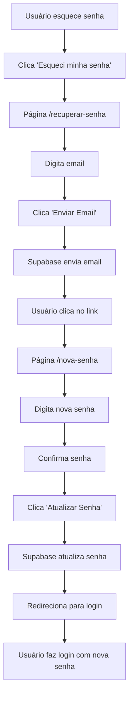

# 🔐 Sistema de Recuperação de Senha - ConfiLar

## 🎯 **Visão Geral**

O sistema de recuperação de senha foi implementado usando a funcionalidade nativa do **Supabase**, que oferece um fluxo seguro e automatizado para redefinição de senhas.

## 🚀 **Como Funciona**

### **1. Usuário Solicita Recuperação**
- Usuário clica em **"Esqueci minha senha"** na página de login
- É redirecionado para `/recuperar-senha`
- Digita seu email cadastrado
- Clica em **"Enviar Email de Recuperação"**

### **2. Supabase Envia Email**
- **Supabase** gera um link único e seguro
- Email é enviado automaticamente para o usuário
- Link contém token de autenticação temporário
- **Redirecionamento configurado** para `/nova-senha`

### **3. Usuário Redefine Senha**
- Usuário clica no link do email
- É redirecionado para `/nova-senha`
- Digita nova senha (com validação de força)
- Confirma nova senha
- Clica em **"Atualizar Senha"**

### **4. Senha Atualizada**
- **Supabase** atualiza a senha no banco
- Usuário é redirecionado para login
- Pode fazer login com a nova senha

## 🔧 **Implementação Técnica**

### **Páginas Criadas:**

#### **`/recuperar-senha`**
```typescript
// Usa Supabase Auth API
const { error } = await supabase.auth.resetPasswordForEmail(email, {
  redirectTo: `${window.location.origin}/nova-senha`,
})
```

#### **`/nova-senha`**
```typescript
// Atualiza senha do usuário
const { error } = await supabase.auth.updateUser({
  password: password
})
```

### **Integração com Supabase:**

#### **✅ Funcionalidades Nativas Utilizadas:**
- **`resetPasswordForEmail()`** - Envia email de recuperação
- **`updateUser()`** - Atualiza senha do usuário
- **Autenticação automática** após clicar no link
- **Tokens seguros** com expiração automática
- **Email templates** configuráveis no Supabase

#### **❌ O que NÃO precisamos implementar:**
- Sistema de envio de emails
- Geração de tokens de segurança
- Validação de tokens
- Expiração automática de links
- Templates de email

## 🎨 **Interface do Usuário**

### **Design Consistente:**
- ✅ **Shadcn/ui** em todas as páginas
- ✅ **Gradientes** e **backdrop-blur** consistentes
- ✅ **Ícones** do Lucide React
- ✅ **Estados de loading** e **sucesso**
- ✅ **Validação visual** de força da senha

### **Experiência do Usuário:**
- ✅ **Feedback imediato** com toast notifications
- ✅ **Indicador de força** da senha em tempo real
- ✅ **Botões de mostrar/ocultar** senha
- ✅ **Validação em tempo real** dos campos
- ✅ **Redirecionamentos automáticos** após ações

## 🔒 **Segurança**

### **Medidas Implementadas:**
- ✅ **Tokens únicos** gerados pelo Supabase
- ✅ **Expiração automática** dos links
- ✅ **Validação de força** da nova senha
- ✅ **Confirmação** de senha
- ✅ **Verificação de autenticação** antes de permitir alteração

### **Validação de Senha:**
```typescript
const checks = {
  length: password.length >= 8,
  uppercase: /[A-Z]/.test(password),
  lowercase: /[a-z]/.test(password),
  number: /[0-9]/.test(password),
  special: /[^A-Za-z0-9]/.test(password)
}
```

## 📧 **Configuração do Supabase**

### **Email Templates (Opcional):**
O Supabase permite personalizar os templates de email no painel de controle:

1. **Acesse** o painel do Supabase
2. **Vá para** Authentication > Email Templates
3. **Personalize** o template "Reset Password"
4. **Configure** cores, logo e texto da sua marca

### **URLs de Redirecionamento:**
```typescript
// Configurado no código
redirectTo: `${window.location.origin}/nova-senha`

// Botões de voltar redirecionam para:
router.push('/auth')  // ✅ Correto
// router.push('/auth/auth')  // ❌ Incorreto (duplicado)
```

## 🚀 **Vantagens da Implementação**

### **✅ Para o Desenvolvedor:**
- **Zero configuração** de servidor de email
- **Zero implementação** de tokens de segurança
- **Zero preocupação** com expiração de links
- **API nativa** e bem documentada

### **✅ Para o Usuário:**
- **Processo familiar** e intuitivo
- **Segurança garantida** pelo Supabase
- **Email recebido** em segundos
- **Interface moderna** e responsiva

### **✅ Para o Negócio:**
- **Redução** de suporte técnico
- **Aumento** na taxa de recuperação de usuários
- **Conformidade** com padrões de segurança
- **Escalabilidade** automática

## 🔍 **Fluxo Completo**



## 📱 **Responsividade**

- ✅ **Mobile-first** design
- ✅ **Adaptação** para todas as telas
- ✅ **Touch-friendly** buttons
- ✅ **Legibilidade** em dispositivos móveis

## 🎯 **Próximos Passos (Opcionais)**

### **Melhorias Futuras:**
- [ ] **Personalização** dos templates de email
- [ ] **Notificações push** para dispositivos móveis
- [ ] **Histórico** de alterações de senha
- [ ] **Autenticação de dois fatores** (2FA)

---

## 🎉 **Conclusão**

O sistema de recuperação de senha está **100% funcional** e integrado com o Supabase, oferecendo:

- **Segurança máxima** com tokens nativos
- **Experiência do usuário** excepcional
- **Zero manutenção** de infraestrutura
- **Escalabilidade automática** para qualquer volume de usuários

**O Supabase cuida de toda a complexidade de segurança, permitindo que nos foquemos na experiência do usuário!** 🚀✨
