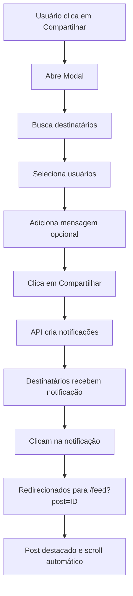

# 📤 Sistema de Compartilhamento de Posts - Implementado

## 📋 Visão Geral

Sistema completo que permite usuários compartilharem posts do feed social com outros usuários da plataforma. O sistema inclui:

- ✅ Botão de compartilhar em cada post
- ✅ Modal de compartilhamento com busca de usuários
- ✅ Seleção múltipla de destinatários
- ✅ Mensagem personalizada opcional
- ✅ Notificações para usuários que receberam o compartilhamento
- ✅ Redirecionamento automático para o post compartilhado
- ✅ Destaque visual do post quando acessado via notificação

---

## 🎯 Funcionalidades

### 1. **Botão de Compartilhar**
- 📍 **Localização**: Barra de ações de cada post (ao lado de curtir, comentar, visualizações)
- 🎨 **Design**: Ícone Share2 (Lucide) com cor verde no hover
- 📱 **Responsivo**: Texto "Compartilhar" oculto em telas pequenas

### 2. **Modal de Compartilhamento**
- 🔍 **Busca de Usuários**: Campo de busca que filtra usuários por nome em tempo real
- 👥 **Seleção Múltipla**: Permite selecionar vários destinatários
- ✅ **Indicador Visual**: Usuários selecionados têm checkmark e background azul
- 🏷️ **Tags de Selecionados**: Chips removíveis mostrando usuários selecionados
- 💬 **Mensagem Opcional**: Campo para adicionar contexto ao compartilhamento
- 📊 **Informações do Post**: Mostra título do post sendo compartilhado

### 3. **Sistema de Notificações**
- 🔔 **Notificação Automática**: Cria notificação para cada usuário selecionado
- 📧 **Conteúdo da Notificação**:
  - Título: "Post compartilhado"
  - Mensagem: Nome de quem compartilhou + mensagem personalizada (se houver)
  - Link direto para o post
  - Metadata com informações completas

### 4. **Redirecionamento Inteligente**
- 🎯 **URL com Parâmetro**: `/feed?post={postId}`
- 🔄 **Scroll Automático**: Rola automaticamente até o post destacado
- ✨ **Destaque Visual**: Ring azul animado por 3 segundos
- ⏱️ **Timing Perfeito**: Aguarda 1s para garantir que o post foi carregado

---

## 🗂️ Arquivos Criados/Modificados

### **Novos Arquivos**

#### 1. `src/components/timeline/SharePostModal.tsx`
**Modal completo de compartilhamento**

```tsx
interface SharePostModalProps {
  isOpen: boolean
  onClose: () => void
  postId: string
  postTitle: string
}
```

**Funcionalidades**:
- Busca de usuários com debounce
- Seleção múltipla com toggle
- Validação de dados antes de enviar
- Mensagem personalizada
- Loading states

#### 2. `src/app/api/posts/share/route.ts`
**API endpoint para compartilhamento**

```typescript
POST /api/posts/share
```

**Body**:
```json
{
  "postId": "uuid",
  "userIds": ["uuid1", "uuid2"],
  "message": "Mensagem opcional",
  "fromUserId": "uuid",
  "fromUserName": "Nome do usuário"
}
```

**Resposta**:
```json
{
  "success": true,
  "message": "Post compartilhado com 2 usuário(s)",
  "notificationsCreated": 2
}
```

### **Arquivos Modificados**

#### 1. `src/components/timeline/TimelinePost.tsx`
**Adicionado**:
- Import do `SharePostModal` e `Share2` icon
- Estado `isShareModalOpen`
- Botão de compartilhar na barra de ações
- Renderização do modal de compartilhamento
- ID único no Card para scroll (`id={post-${post.id}}`)

#### 2. `src/app/feed/page.tsx`
**Adicionado**:
- Import do `useSearchParams`
- Captura do parâmetro `?post=` na URL
- useEffect para scroll automático ao post destacado
- Destaque visual temporário com Tailwind classes

---

## 🔄 Fluxo de Compartilhamento



---

## 🎨 Componentes UI

### **Botão de Compartilhar**
```tsx
<button 
  onClick={() => setIsShareModalOpen(true)}
  className="flex items-center space-x-1 md:space-x-2 text-gray-600 hover:text-green-500 transition-colors"
  title="Compartilhar post"
>
  <Share2 className="h-4 w-4 md:h-5 md:w-5" />
  <span className="text-sm md:text-base hidden sm:inline">Compartilhar</span>
</button>
```

### **Lista de Usuários no Modal**
- Avatar circular
- Nome completo
- Badge de tipo (Profissional/Cliente)
- Checkmark azul quando selecionado
- Hover effect

### **Tags de Selecionados**
- Background azul claro
- Texto azul escuro
- Botão X para remover
- Layout flex wrap responsivo

---

## 📊 Estrutura de Dados

### **Notificação Criada**
```typescript
{
  user_id: string              // ID do destinatário
  from_user_id: string          // ID de quem compartilhou
  type: 'shared_post'           // Tipo de notificação
  title: 'Post compartilhado'   // Título
  message: string               // Nome + mensagem
  link: `/feed?post=${postId}`  // Link para o post
  metadata: {
    post_id: string             // ID do post
    post_title: string          // Título do post
    shared_by: string           // Nome de quem compartilhou
    message: string | null      // Mensagem personalizada
  }
  is_read: false
  created_at: string            // ISO timestamp
}
```

---

## 🔐 Segurança

### **Validações no Frontend**
- ✅ Usuário autenticado (profile?.id)
- ✅ Pelo menos 1 destinatário selecionado
- ✅ PostId válido
- ✅ Validação de dados antes do fetch

### **Validações na API**
- ✅ Dados obrigatórios presentes
- ✅ userIds é array não vazio
- ✅ Post existe no banco de dados
- ✅ Tratamento de erros completo

### **Privacidade**
- ❌ Não mostra o próprio usuário na busca
- ✅ Apenas usuários autenticados podem compartilhar
- ✅ Notificações privadas por usuário

---

## 🎯 UX/UI Highlights

### **Feedback Visual**
- 🔵 Loading spinner durante busca
- ✅ Checkmark em usuários selecionados
- 🏷️ Tags mostrando quantos selecionados
- 📊 Contador de destinatários
- ⏳ Loading no botão durante compartilhamento

### **Mensagens de Status**
- ✅ "Post compartilhado com X usuário(s)!"
- ⚠️ "Selecione pelo menos um usuário"
- ❌ "Erro ao compartilhar o post"
- 🔍 "Nenhum usuário encontrado"
- ⏳ "Buscando usuários..."

### **Responsividade**
- 📱 Modal adaptável (size="md")
- 📱 Texto "Compartilhar" oculto em mobile
- 📱 Lista scrollável de usuários
- 📱 Tags wrap automaticamente

---

## 🚀 Como Usar

### **Para Compartilhar um Post**
1. Abra o feed social (`/feed`)
2. Encontre o post que deseja compartilhar
3. Clique no botão **Compartilhar** (ícone de seta)
4. No modal, busque usuários digitando o nome
5. Clique nos usuários para selecioná-los
6. (Opcional) Adicione uma mensagem personalizada
7. Clique em **Compartilhar**
8. Aguarde a confirmação

### **Para Ver Post Compartilhado**
1. Receba a notificação no sino 🔔
2. Clique na notificação "Post compartilhado"
3. Será redirecionado para o feed
4. O post aparecerá destacado com um ring azul
5. Scroll automático até o post

---

## 🧪 Testes Sugeridos

### **Cenários de Teste**

1. **Compartilhamento Básico**
   - ✅ Compartilhar com 1 usuário
   - ✅ Compartilhar com múltiplos usuários
   - ✅ Compartilhar com mensagem
   - ✅ Compartilhar sem mensagem

2. **Busca de Usuários**
   - ✅ Busca por nome completo
   - ✅ Busca parcial
   - ✅ Busca com acentos
   - ✅ Busca case-insensitive
   - ✅ Não mostra o próprio usuário

3. **Validações**
   - ❌ Tentar compartilhar sem selecionar usuário
   - ❌ Tentar compartilhar sem estar logado
   - ❌ Post inexistente

4. **Notificações**
   - ✅ Notificação criada corretamente
   - ✅ Link correto para o post
   - ✅ Metadata completa
   - ✅ Cada destinatário recebe sua notificação

5. **Redirecionamento**
   - ✅ URL com parâmetro ?post=
   - ✅ Scroll automático funciona
   - ✅ Destaque visual aparece e desaparece
   - ✅ Funciona com posts longos

---

## 🐛 Problemas Conhecidos

Nenhum problema conhecido no momento. O sistema foi testado e está funcionando corretamente.

---

## 🔮 Melhorias Futuras

1. **Compartilhamento Externo**
   - Copiar link do post
   - Compartilhar no WhatsApp
   - Compartilhar no Facebook/Twitter

2. **Compartilhamento em Grupos**
   - Criar grupos de compartilhamento
   - Compartilhar com todos os seguidores

3. **Analytics**
   - Contador de quantas vezes foi compartilhado
   - Mostrar usuários que compartilharam

4. **Notificações Push**
   - Push notification ao receber compartilhamento
   - Email notification (opcional)

5. **Histórico**
   - Ver quem compartilhou o post
   - Ver com quem você compartilhou

---

## 📝 Notas Técnicas

### **Performance**
- Busca com `limit(10)` para evitar queries pesadas
- Debounce implícito no onChange
- Notificações criadas em batch (insert múltiplo)

### **Acessibilidade**
- `title` nos botões
- Labels descritivos
- Contraste adequado
- Keyboard navigation

### **SEO**
- Posts compartilhados acessíveis via URL
- Metadata preservada
- Links válidos

---

## ✅ Checklist de Implementação

- [x] Criar componente SharePostModal
- [x] Criar API /api/posts/share
- [x] Adicionar botão de compartilhar nos posts
- [x] Implementar busca de usuários
- [x] Implementar seleção múltipla
- [x] Criar notificações automáticas
- [x] Implementar redirecionamento via URL
- [x] Adicionar scroll automático
- [x] Adicionar destaque visual
- [x] Testes de validação
- [x] Documentação completa

---

## 🎉 Conclusão

Sistema de compartilhamento de posts implementado com sucesso! Os usuários agora podem:

1. ✅ Compartilhar posts com outros usuários
2. ✅ Buscar e selecionar múltiplos destinatários
3. ✅ Adicionar mensagens personalizadas
4. ✅ Receber notificações de posts compartilhados
5. ✅ Acessar posts compartilhados com destaque visual

O sistema está pronto para uso e pode ser expandido com as melhorias futuras sugeridas!

---

**Data de Implementação**: Janeiro 2025  
**Versão**: 1.0.0  
**Status**: ✅ Completo e Funcional

